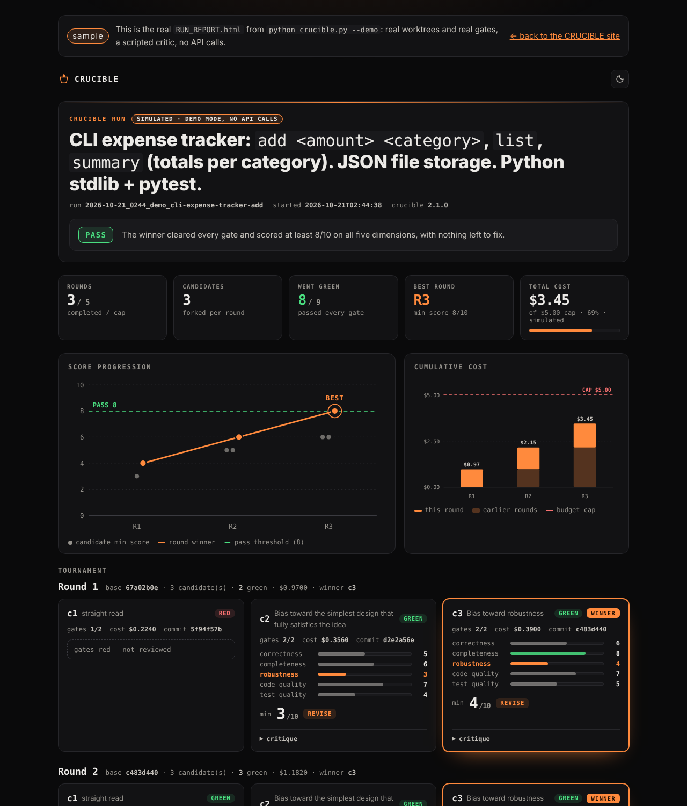

<div align="center">

# CRUCIBLE

### One idea in, working repo out.

**[Live site](https://crucible.charanreddy.dev)** · **[How it works](#how-it-works)** · **[Deep dive](docs/PROJECT_DEEP_DIVE.md)** · **[Deploy](docs/DEPLOYMENT.md)**

[](https://github.com/charanreddy-27/CRUCIBLE/actions/workflows/ci.yml)
[](https://www.python.org/)
[](LICENSE)

</div>

---

CRUCIBLE runs Claude Code in a loop. Several builders race the same problem in
isolated git worktrees, deterministic gates judge the result, a critic that has
never seen the build scores it, and plain Python decides whether it's actually
done.

**"Good enough" is a rule here, not a feeling.**

<p align="center">
  
</p>

<p align="center"><sub>A real <code>RUN_REPORT.html</code>, from <code>python crucible.py --demo</code> — <a href="https://crucible.charanreddy.dev/report">open it live</a>.</sub></p>

## The problem

Ask a model whether its own code is good and it will tell you yes. It's grading
in the same context that produced the work, which makes it agreeable in exactly
the way a reviewer must not be. So you become the loop — pasting tracebacks
back in, eyeballing diffs, deciding on no particular basis that this is
probably fine, then discovering two versions ago was better and you didn't keep
it.

CRUCIBLE takes three decisions away from the model:

| Decision | Who makes it |
|---|---|
| Does the code run? | `pytest` and `ruff`, run by the controller |
| Is the code any good? | A separate session, read-only tools, no memory of the build |
| Should we stop? | Rules in plain Python — pass, round cap, stall, budget |

What's left for the model is the part it's good at: writing the thing.

## How it works

Every round is a tournament. N builders fork from the same commit into isolated
git worktrees and work in parallel, each under a different emphasis. Only
gates-green candidates reach the critic. The winner fast-forwards onto trunk;
the losers stay as branches.

```
              trunk @ a1b2c3d
                     │
       ┌─────────────┼─────────────┐
       ▼             ▼             ▼
   candidate 1   candidate 2   candidate 3     fresh session each,
   straight      simplest      robustness      own worktree, parallel
       │             │             │
       ▼             ▼             ▼
   gates ✗       gates ✓       gates ✓         pytest + ruff, by the
       │             │             │            controller — never a model
       ✕             ▼             ▼
  not reviewed  critic 7/10   critic 9/10      read-only tools, no
                     │             │            memory of the build
                     └──────┬──────┘
                            ▼
                   winner → trunk               ff-only, tagged round-N
```

### Six invariants

1. **Fresh context every round.** No `--resume`. The repo on disk is the state; the prompt carries the idea and the latest feedback.
2. **The controller is code.** Stop decisions are rules, first match wins. No model votes on whether it's finished.
3. **The critic is a stranger.** Separate invocation, read-only tools, adversarial rubric, and a stronger model than the builder.
4. **Best ≠ last.** Every round is a commit and a tag. The run returns the highest-scoring round.
5. **A chain is its weakest link.** A round scores `min()` across five dimensions, so brilliant code with hollow tests does not pass.
6. **Losers are kept.** Every candidate survives as a branch. The rejected approach is often the more interesting diff.

## Features

- **Best-of-N tournament** per round, in real git worktrees — no copying, no collisions
- **Decorrelated candidates** — each builder gets a different emphasis, because identical prompts produce identical answers
- **Deterministic gates** the model never runs and cannot sweet-talk
- **Schema-enforced critique** via `--json-schema`, so no regex and no parse-retry loop
- **Anti-gaming rubric** — `test_quality` is scored separately and capped at 4 for vacuous tests
- **Fault tolerance** — a dead builder drops its candidate, not the run
- **Full forensics** — every round writes `builder.json`, `gates.txt`, `critique.json`, `selection.json`, and a `RUN_REPORT.md`
- **An HTML run report** — `RUN_REPORT.html`: score progression, cost against budget, and every candidate's rubric scores, in one offline file
- **An offline demo** — `--demo` runs a whole tournament against a simulated `claude`: no API key, no cost, real gates
- **Rule-based stopping** — `pass` / `max_rounds` / `stalled` / `budget`, with a hard cost cap

## Quickstart

```bash
git clone https://github.com/charanreddy-27/CRUCIBLE.git
cd CRUCIBLE
pip install -r requirements.txt        # pytest, pytest-timeout, ruff

python crucible.py --demo              # watch a whole tournament first — offline, free
python crucible.py "CLI expense tracker: add, list, summary. JSON storage."
```

`--demo` needs no API key and no `claude` CLI. It launches a scripted `claude`
([`demo/fake_claude.py`](demo/fake_claude.py)) by absolute path — never by name,
so it can't fall through to a real install — and runs the real controller
against it — real worktrees, real `pytest` and `ruff` gates, real
promotion and stop rules — so you can watch three rounds of an expense tracker
get better in a few seconds: a candidate goes red on a genuine bug, scores
climb as the critic's findings are fixed, and round 3 passes. Costs shown are
simulated, and the run is labelled as such everywhere. It needs the repository
checkout, not just the pip-installed module.

You also need the [`claude` CLI](https://code.claude.com/docs/en/headless) on
PATH. CRUCIBLE refuses to start if a gate tool, prompt template or the critic
schema is missing — a skipped gate is a lie about the result.

```bash
python crucible.py IDEA.md          # from a structured idea file
python crucible.py IDEA.md -n 5     # five candidates per round
python crucible.py IDEA.md -n 1     # sequential: one builder per round

python crucible.py IDEA.md -n 1 --budget 3 --max-rounds 3   # try it cheaply
```

`--budget` and `--max-rounds` override the module defaults per run. Worth knowing
before your first real run: every `claude` invocation carries roughly $0.20 of
cache creation before it does any work, so a wide run adds up faster than the
per-round costs suggest.

### Getting the result

```bash
cd runs/<run-id>/workspace
git checkout best                   # highest-scoring round, not the last
git branch --list 'cand-*'          # the roads not taken
git diff round-2 cand-r2-1          # what the losing attempt did differently
```

Each run also leaves a `RUN_REPORT.md` with the whole tournament — who ran, who
went green, who won, and what it cost — and a `RUN_REPORT.html` beside it that
shows the same at a glance: score progression across rounds, cumulative cost
against the budget, and a card per candidate with its five rubric scores and the
critic's findings. It is a single self-contained file that opens offline.

```bash
python crucible.py --report runs/<run-id>   # re-render a past run's RUN_REPORT.html
```

Terminal output is colored when stdout is a terminal; set `NO_COLOR=1` to turn
that off, or `FORCE_COLOR=1` to keep it through a pipe.

## Tech stack

| | Why |
|---|---|
| **Python 3.11**, stdlib only | The component deciding when to stop should be the most boring code in the repo |
| **Claude Code headless** (`claude -p`) | A real agent with real tools behind a JSON envelope reporting cost, turns and errors |
| **`--json-schema`** | The critic's verdict is schema-enforced at the CLI — no parsing, no retries |
| **git worktrees** | Isolation without copying; losers stay inspectable as branches |
| **pytest + ruff** | Deterministic gates, impossible to sweet-talk |
| **ThreadPoolExecutor** | The work is subprocess-bound, so threads are plenty |

## Testing

```bash
python -m pytest tests/ -q
ruff check .
```

The interesting logic decides which of several *model outputs* wins — untestable
against a real model. So the suite ships a fake `claude` CLI
([`tests/fake_claude.py`](tests/fake_claude.py)) that speaks the same JSON
envelope and hands each candidate deliberately different quality. The end-to-end
tests then run real loops — real worktrees, real gates — and assert that the
right candidate won.

The fake also *enforces* the real CLI's contract rather than merely impersonating
it. That distinction matters: an earlier version accepted anything after
`--json-schema`, which kept the suite green while the critic could never have
worked against the real CLI. See
[the deep dive](docs/PROJECT_DEEP_DIVE.md#when-the-fake-lied).

(The demo's fake, [`demo/fake_claude.py`](demo/fake_claude.py), is a separate
script with a different job: telling a plausible story rather than pinning down
an assertion. It honours the same contract.)

## Does it actually work?

Yes — [here's the recorded run](docs/ACCEPTANCE_RUN.md).

Round 1 passed **both gates** (`pytest` green, `ruff` clean) and the critic still
returned 13 blocking defects, scoring it 3/10. Among them: `if amount <= 0`
doesn't reject NaN or Infinity, because every NaN comparison is False and
`inf <= 0` is False — so `add nan food` was accepted. It also flagged a test
asserting `'Error' in stderr`, which would pass on any error text.

Round 2 fixed them — `math.isfinite`, atomic temp-file writes, `allow_nan=False`,
14 → 26 tests — and scored 6/10. The run stopped on `budget` at $3.12, tagged
round 2 as `best`, and `git checkout best` yields 40 passing tests and a CLI that
does what was asked.

That is the whole thesis in one run: **green gates are necessary, never
sufficient.**

## Documentation

| | |
|---|---|
| [`docs/PROJECT_DEEP_DIVE.md`](docs/PROJECT_DEEP_DIVE.md) | Architecture, data flow, folder structure, tradeoffs |
| [`docs/INTERVIEW_PREP.md`](docs/INTERVIEW_PREP.md) | Walkthrough, STAR stories, likely Q&A |
| [`docs/ACCEPTANCE_RUN.md`](docs/ACCEPTANCE_RUN.md) | A real recorded run: what the critic caught and what it cost |
| [`docs/DEPLOYMENT.md`](docs/DEPLOYMENT.md) | Shipping the site to Vercel, plus the manual checklist |
| [`CRUCIBLE_SPEC.md`](CRUCIBLE_SPEC.md) | The original v1 design record |
| [`CHANGELOG.md`](CHANGELOG.md) | What changed and when |

## Safety

Builders run with `--dangerously-skip-permissions`. That is acceptable **only
because** each one's working directory is a throwaway candidate worktree created
by the run. **Never point CRUCIBLE at an existing repo.**

For scoped permissions instead, set `BUILDER_ALLOWED_TOOLS` in `crucible.py` or
export `CRUCIBLE_BUILDER_ALLOWED_TOOLS`:

```bash
export CRUCIBLE_BUILDER_ALLOWED_TOOLS="Edit,Write,Read,Glob,Grep,Bash(git *),Bash(python *),Bash(pytest *),Bash(ruff *)"
```

**Running as root?** The CLI refuses `--dangerously-skip-permissions` under
root or sudo, so containers and CI must take the scoped path. Preflight checks
for this and says so up front, rather than letting every builder invocation die
on an unparseable envelope.

---

## About the developer

I'm **Charan** — an AI & Automation Engineer in Bangalore. I ship production LLM
systems: a Springer-published model that reads chest X-rays well enough for a
radiologist to take seriously, and document pipelines that run themselves once
you stop watching them.

Before any of that, I wrote real-time control code for jet engines at DRDO. That
job teaches you something the notebook never will: a millisecond of lag isn't a
bug — it's a flameout.

This is one project. The rest of them live at
**[charanreddy.dev](https://www.charanreddy.dev)**.

**Want to build something — or break something interesting?**

[Book a call](https://cal.com/charanreddy-27/30min) ·
[Email](mailto:charanreddychanda@gmail.com) ·
[LinkedIn](https://www.linkedin.com/in/chandacharanreddy/) ·
[GitHub](https://github.com/charanreddy-27) ·
[ORCID](https://orcid.org/0009-0003-2414-6717)

<sub>MIT licensed. Crafted with intent.</sub>
